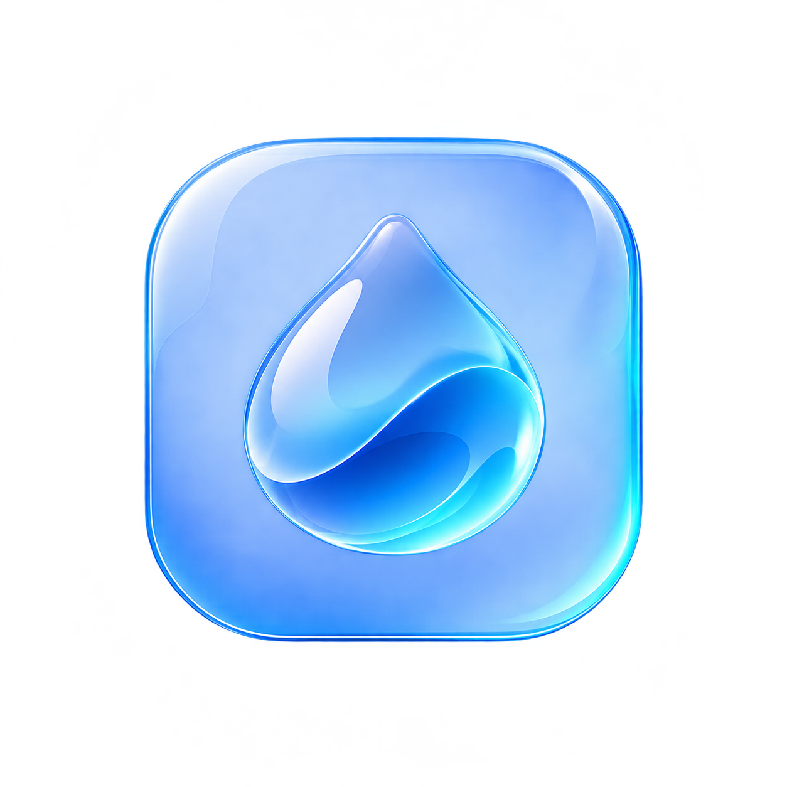

<div align="center">
  
  <h1>@iaceene/liquid-glass</h1>
  <p><strong>A production-ready React component library crafted in the Nimbus liquid-glass & Frutiger Aero aesthetic.</strong></p>

  <p>
    <a href="https://www.npmjs.com/package/@iaceene/liquid-glass"></a>
    <a href="https://github.com/iaceene/liquid-glass/blob/main/LICENSE"></a>
    <a href="https://iaceene.github.io/liquid-glass/"></a>
    
    
  </p>
</div>

---

Frosted glass surfaces with physical backdrop blur, real-time WebGL water shaders, spring-physics droplet shedding, fluid surface ripples, living pointer menisci, and full keyboard & screen reader accessibility.

- 📖 **[Interactive Storybook Demo](https://iaceene.github.io/liquid-glass/)**
- 📚 **[Full API Documentation & Component Specs](docs/COMPONENTS.md)**

---

## 📦 Component Suite

| Category | Components |
|---|---|
| **Forms & Inputs** | `LiquidButton`, `LiquidInput`, `LiquidTextarea`, `LiquidCheckbox`, `LiquidSwitch` (`LiquidToggle`), `LiquidLabel`, `LiquidForm` |
| **Navigation** | `LiquidNavbar`, `LiquidSidebar` (`Sidebar`), `LiquidBreadcrumb` (`Breadcrumb`), `LiquidPagination` (`Pagination`), `LiquidTabs` |
| **Code & Editor** | `LiquidEditor` (`Editor` with syntax coloring, tabs, line numbers, typing audio, and liquid border) |
| **Feedback & Status** | `LiquidToast` (`Toaster`, `toast()`), `LiquidAlert` |
| **Overlays & Dialogs** | `LiquidDialog`, `LiquidCommandMenu` (`CommandMenu`), `LiquidDropdownMenu`, `LiquidTooltip`, `LiquidPopover` |
| **Data & Display** | `LiquidCard`, `LiquidCalendar` (`Calendar`), `LiquidTable` (`Table`), `LiquidDataTable` (`DataTable`), `LiquidAccordion`, `LiquidBadge`, `LiquidAvatar`, `LiquidSeparator`, `LiquidSkeleton` |
| **Application Flows** | `LiquidAuth` (`AuthCard`, Unified Sign In & Sign Up + OAuth), `LiquidCheckout` (`WaterCard`) |

---

## ✨ Features

- 💧 **Live Water Engine**: WebGL fragment shaders for caustics, dual specular highlights, fresnel iridescence, and surface tension.
- 🌊 **Spring Droplet Physics**: Leaping satellite droplets, neck-breaking tension snaps, and wave interference ripples.
- 🎨 **Rich Themes & Color Palettes**: `tone="light" | "dark" | "midnight"`, plus `emerald`, `amber`, `violet`, `rose`, `cyan`, `sky`, `deep` palettes.
- 🔔 **Imperative Toast System**: `toast.success()`, `toast.error()`, `toast.info()`, `toast.warning()`, and `<LiquidToaster />` viewport.
- 🎭 **Micro-Animation Scenes**: Dynamic icon animation scenes (`pop`, `plane`, `drop`, `spin`, `glow`, `wave`).
- 🔊 **Synthesized Web Audio**: Frequency-swept water sound effects with zero external audio assets.
- ♿ **Strict Accessibility**: Semantic markup, ARIA live regions/roles, roving tabindex, visible focus rings, and `prefers-reduced-motion` compliance.
- ⚡ **Zero External Animation Dependencies**: Self-contained React implementations with CSS fallbacks when WebGL is unavailable.

---

## 🚀 Installation

Install `@iaceene/liquid-glass` along with its peer dependencies:

```bash
# Using npm
npm install @iaceene/liquid-glass

# Using pnpm
pnpm add @iaceene/liquid-glass

# Using Bun
bun add @iaceene/liquid-glass

# Using Yarn
yarn add @iaceene/liquid-glass
```

> **Using GitHub Packages?**
> If installing via GitHub Packages (`npm.pkg.github.com`), add this line to your project's `.npmrc`:
> ```ini
> @iaceene:registry=https://npm.pkg.github.com
> ```

---

## 💻 Quickstart & Setup

### 1. Import Global Styles
Import the library CSS in your root file (e.g., `main.tsx` in Vite or `app/layout.tsx` in Next.js):

```tsx
import '@iaceene/liquid-glass/styles.css';
```

### 2. Using Components

```tsx
import { 
  LiquidButton, 
  LiquidCard, 
  LiquidToast, 
  toast, 
  LiquidToaster 
} from '@iaceene/liquid-glass';

export default function Dashboard() {
  return (
    <div className="min-h-screen bg-slate-950 p-8 text-white">
      <LiquidCard theme="sky" glowEffect="intense" className="max-w-md p-6">
        <h2 className="text-xl font-bold mb-2">Liquid Glass Dashboard</h2>
        <p className="text-slate-300 text-sm mb-4">
          Experience real-time WebGL caustics and spring-physics droplet ripples.
        </p>

        <LiquidButton
          variant="glow"
          onClick={() => toast.success("Connected to Liquid Glass!", {
            description: "Spring physics initialized successfully."
          })}
        >
          Explore System
        </LiquidButton>
      </LiquidCard>

      {/* Mount toaster viewport once in root layout */}
      <LiquidToaster position="bottom-right" tone="dark" />
    </div>
  );
}
```

---

## 🧩 Component Examples

### Segmented Liquid Tabs with Animated Icons

```tsx
import { LiquidTabs, NimbusTabIcons } from '@iaceene/liquid-glass';

export function NavigationTabs() {
  return (
    <LiquidTabs
      defaultValue="overview"
      variant="emerald"
      items={[
        { value: "overview", label: "Overview", icon: NimbusTabIcons.overview, fx: "glow", badge: "Live" },
        { value: "activity", label: "Activity", icon: NimbusTabIcons.activity, fx: "wave", badge: "12" },
        { value: "code", label: "Code", icon: NimbusTabIcons.code, fx: "spin" },
        { value: "settings", label: "Settings", icon: NimbusTabIcons.settings, fx: "pop" },
      ]}
    />
  );
}
```

### Liquid Code Editor with Syntax Highlighting & Audio Effects

```tsx
import { LiquidEditor } from '@iaceene/liquid-glass';

export function CodeSection() {
  return (
    <LiquidEditor
      language="typescript"
      defaultValue={`import { LiquidButton } from '@iaceene/liquid-glass';\n\nexport const App = () => (\n  <LiquidButton variant="glow">Nimbus</LiquidButton>\n);`}
      enableAudio={true}
      lineNumbers={true}
      glow={true}
    />
  );
}
```

---

## 🎨 Theming & Design System

The design system uses standard HSL CSS variables configured in `src/styles/globals.css`.

### Theme Palettes
Components accept standard tone attributes (`tone="light" | "dark" | "midnight"`), as well as theme colors:
- `sky` (default blue / aqua)
- `cyan` (electric water)
- `emerald` (fresh green)
- `violet` (aurora purple)
- `rose` (warm pink)
- `amber` (sunset gold)

### Switching Themes in HTML:
Add the `dark` class (or `data-theme="dark"` attribute) to your `<html>` or root container:

```html
<html class="dark">
  ...
</html>
```

---

## 🛠️ Local Development

### 1. Clone & Install
```bash
git clone https://github.com/iaceene/liquid-glass.git
cd liquid-glass
npm install
```

### 2. Start Storybook
```bash
npm run storybook
```
Open [http://localhost:6006](http://localhost:6006) to explore interactive components and modify controls in real time.

### 3. Run Tests & Typecheck
```bash
# TypeScript verification
npm run typecheck

# Unit & component tests
npm test

# Build production bundle
npm run build
```

---

## 📄 License

Distributed under the **MIT License**. See [LICENSE](LICENSE) for more information.
